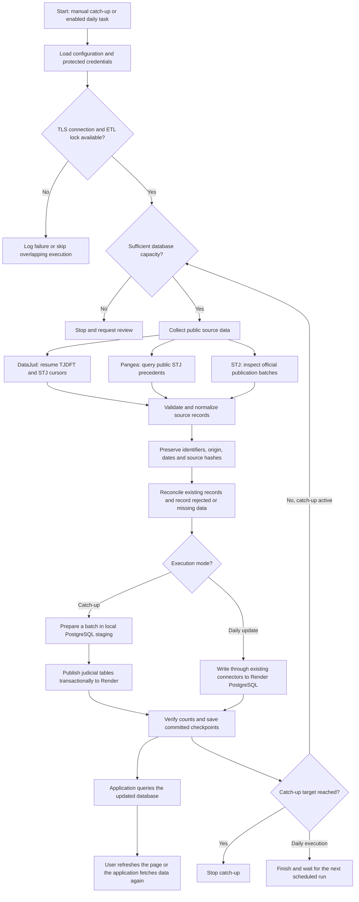
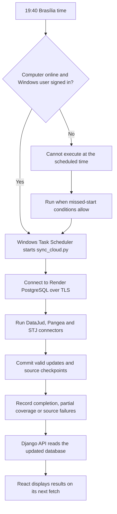

# DatumLex — Data Extraction and Automated Publication

**Date:** October 24, 2026  
**Scope:** Current implementation and the daily update process

## Purpose

The DatumLex data pipeline collects public judicial information, validates and normalizes it, preserves source provenance, and stores processed records in the PostgreSQL database used by the application on Render.

Two execution modes are available:

- **Initial or catch-up loading:** a local staging database prepares batches for transactional publication to Render, stopping at a defined record target.
- **Daily updates:** a Windows scheduled task runs the source connectors and writes updates to Render PostgreSQL through an authorized TLS connection.

The initial target of **10,000 stored records has been reached**. The daily task is configured for **19:40 Brasília time**, but remains **disabled**, pending the team's decision to reactivate it.

## Data Sources

| Source | Information collected | Role in DatumLex |
|---|---|---|
| DataJud — TJDFT and STJ | Public process metadata, subjects, dates, courts, and procedural movements | Supplies the analytical warehouse. A fact represents a source document, not necessarily a unique appeal or CNJ process. |
| Pangea — STJ | Public precedent references and theses, including searches for civil liability, moral damages, and material damages | Supplies candidate legal references. Import does not constitute legal approval. |
| STJ Open Data | Publication metadata and available official text files | Supplies document provenance and available source texts, separately from DataJud facts. |

These populations have different meanings and date fields. They must not be combined indiscriminately when calculating legal indicators.

## Overall Flowchart



The source branches describe logical stages. The current daily implementation executes them sequentially: **DataJud → Pangea → STJ publications**.

## Initial Loading and Catch-Up

The catch-up process uses the following path:

```text
Public APIs → validation and normalization → local PostgreSQL staging
           → transactional batch publication → Render PostgreSQL → Django API → React
```

1. Acquire the ETL advisory lock so another managed collector cannot publish concurrently.
2. Create a separate staging database from the existing judicial warehouse. Preserve the original local database.
3. Resume DataJud from committed source cursors, using batches of up to 500 records. The STJ DataJud batch was reduced to 100 after the provider returned an incomplete response.
4. Reuse the application's normalization, deduplication, outcome classification, and warehouse loading rules locally.
5. Transfer staging snapshots through PostgreSQL `COPY` and reconcile them within a remote transaction. Remove movements and subject links removed by the corresponding source snapshot.
6. Check record counts and outcome categories, commit publication, and save a checkpoint.
7. Repeat until the target is reached or a safety condition requires stopping.

The publisher does not write account, password, permission, or session tables. Its reconciliation logic was checked for repeated publication, obsolete-event removal, row counts, and semantic outcome mapping.

The target counts stored DataJud facts, legal references, and STJ publication metadata. It excludes movements, bridge rows, versions, and ingestion logs. **The operational total does not represent unique legal cases across sources.**

## Daily Extraction and Automatic Publication

When the daily task is enabled, the process is:



Current daily configuration:

| Item | Configuration |
|---|---|
| Task | `DatumLex-Cloud-ETL` |
| Time | Daily at 19:40, using the Windows Brasília time zone |
| Current status | Disabled |
| Entry point | `D:\Api\datumlex-operations\sync_cloud.py` |
| DataJud limit | Up to 10 pages per court per execution; resumed runs retain their saved page sizes |
| Pangea limit | Up to 5 pages of 100 results per search |
| Pangea searches | `responsabilidade civil`, `dano moral`, `dano material` |
| STJ publications | Bounded search of recent available batches, avoiding already processed dates without schema failures |
| Destination | Render PostgreSQL |
| Network access | TLS, with external database access restricted to the authorized computer IP |
| Monitoring | Rotating local logs and Windows task results |

The daily task does not repeat catch-up indefinitely. However, a partly loaded historical DataJud scope continues from its cursor before the existing synchronization command begins incremental refresh. Page limits bound an invocation; they do not establish complete source coverage.

## Data Quality and Recovery

- **Deduplication:** preserve source identifiers and reconcile existing rows. Different searches may return the same Pangea reference.
- **Dates:** DataJud filing dates, STJ publication dates, and reviewed decision dates retain their separate meanings.
- **Source provenance:** retain source URLs, ingestion runs, identifiers, and available content hashes.
- **Incomplete responses:** do not load a DataJud page that the connector identifies as incomplete. Previously committed pages remain available.
- **Interrupted publication:** remote transactions protect a batch from partial application. Checkpoints and staging support recovery.
- **Missing texts:** record unavailable archive members explicitly; do not synthesize judicial text.
- **Legal review:** imported Pangea references remain pending approval. The operational wrapper preserves existing human approval for unchanged source content; changed content requires review.
- **User access:** publication of judicial data does not replace accounts or change the support password.

## What Is Automatic and What Remains Separate

| Process | Mechanism | Current status |
|---|---|---|
| Application deployment | GitHub changes on `main` trigger Render deployment | Configured |
| Catch-up publication | Local staging worker publishes batches until its target | Completed at 10,000 total records |
| Daily source updates | Windows Task Scheduler runs the ETL | Configured, disabled |
| Legal approval | Human review of imported references | Not automatic |
| Serving collected STJ text files | Requires accessible durable file storage and application support | Local text collection does not automatically provide this |

**Updating GitHub deploys code; running ETL updates data.** The hosted application reads Render PostgreSQL, not the original database inside the local Docker container. Arbitrary edits to that original local database are not automatically replicated to the cloud.

STJ text files currently remain on the computer. Their metadata and provenance are in Render PostgreSQL. The application needs a separate file-storage arrangement before those local files can be reliably downloaded through the hosted site.

## Operational Requirements

For local automation to work, the computer, Docker when staging is required, internet connection, and Windows user session must remain available. A changed public IP requires updating the authorized database rule.

The current Render database is a temporary free instance. Its dashboard shows expiration on **November 23, 2026**. The ETL cannot extend that expiration or replace a backup policy. Storage safeguards stop collection rather than purchasing an upgrade automatically.

## Why This Process Fits DatumLex

The process reuses the existing Django data rules, separates source collection from application deployment, and makes published changes visible through the same database used by the API. Local staging reduces the cost of repeated database round trips during large initial loads, while transactions, source identifiers, and checkpoints support consistent publication and recovery. The bounded daily task provides a practical update path for the academic deployment once the team chooses to enable it.
