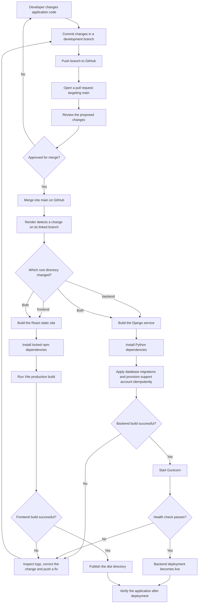

# DatumLex — GitHub to Render Deployment Automation

**Date:** October 24, 2026  
**Scope:** Automatic deployment of application code

## Purpose

DatumLex connects its GitHub repository to Render so approved code changes can be published without manually uploading application files.

Git records changes locally. GitHub hosts the shared repository. Render obtains the selected revision from GitHub, runs the configured build commands, and deploys the application.

## Current Configuration

| Setting | Backend | Frontend |
|---|---|---|
| GitHub repository | `DatumLex/datumlex-core` | `DatumLex/datumlex-core` |
| Deployment branch | `main` | `main` |
| Render service | `datumlex-demo-api` | `datumlex-demo-web` |
| Service type | Python web service | Static site |
| Root directory | `backend/` | `frontend/` |
| Automatic deployment | **On Commit** | **On Commit** |
| Runtime | Django and Gunicorn | React and Vite build output |

Render supports linked-branch deployment and the **On Commit** trigger described in its [deployment documentation](https://render.com/docs/deploys).

## Flowchart



The pull request and review stages describe the team's intended development workflow. Render's **On Commit** trigger responds to a change reaching `main`, including a direct push. Requiring a reviewed pull request must be enforced separately through GitHub repository rules.

## Step-by-Step Explanation

### 1. Develop and commit

A developer changes the backend, frontend, or both. A commit records that change in Git, and a push makes it available in the GitHub repository.

Pushing only to a development branch does not trigger the current `main` deployments. The change must reach the branch linked to the Render services.

### 2. Review and merge

The team opens a pull request, reviews its changes, and merges the approved work into `main`. This makes the new revision available to the deployment services.

Code review and automated tests provide release evidence. The current Render setting does not itself require a passing GitHub Actions workflow.

### 3. Render selects the affected service

Both services use the same repository, with separate root directories:

- Changes inside `backend/` can trigger the backend deployment.
- Changes inside `frontend/` can trigger the frontend deployment.
- Changes affecting both directories can trigger both services.

Changes outside a service's configured root directory do not automatically trigger that service. Shared files outside those directories need deliberate deployment handling. See [Render's monorepo documentation](https://render.com/docs/monorepo-support).

### 4. Build and deploy the backend

The backend build command is:

```bash
pip install -r requirements.txt && python manage.py migrate --noinput && python manage.py bootstrap_support
```

This installs the declared dependencies, applies pending Django migrations, and ensures the support account exists. The provisioning command does not reset an existing support password.

After a successful build, Render starts the service with:

```bash
gunicorn config.wsgi:application --bind 0.0.0.0:$PORT --workers 1 --timeout 120
```

The health-check path is:

```text
/api/health/
```

These commands run from `backend/`. Connection settings and application secrets are supplied through the Render environment rather than committed credentials.

Migrations currently run during the build because the free service lacks a pre-deploy command. A failed deployment does not imply that an already applied database migration was undone. Database changes therefore require compatible migrations and an appropriate backup and recovery plan.

### 5. Build and publish the frontend

The frontend build command is:

```bash
npm ci && npm run build
```

It runs from `frontend/`. Render publishes the generated `dist` directory. The `VITE_API_BASE_URL` build variable points the frontend to the Django API.

Because Vite embeds this variable in the generated frontend, changing the API URL requires rebuilding the frontend.

### 6. Verify the release

After deployment, the team checks:

- Deployment status and logs in Render.
- Backend health-check response.
- Login and permissions through the application.
- Relevant filters and indicators affected by the change.

The frontend and backend deploy independently. A change affecting both should remain compatible while one deployment finishes before the other.

## Relationship with CI

| Mechanism | Responsibility | Current state |
|---|---|---|
| Git and GitHub | Version and share source code | In use |
| Pull request review | Assess a proposed change before merging | Team workflow; enforcement depends on repository rules |
| GitHub Actions CI | Automatically verify code, tests, and build | A required CI gate has not been established for this deployment |
| Render On Commit | Build and deploy when the linked branch changes | Active on both application services |
| Render After CI Checks Pass | Wait for successful checks before deploying | Available as a future configuration, not currently enabled |

The intended improvement is to establish reliable automated checks and then switch Render to **After CI Checks Pass**. Render documents the supported checks and trigger behavior in its [deployment guide](https://render.com/docs/deploys).

## Application Code and Judicial Data Are Separate

```text
Code changes:
Git commit → GitHub main → Render build → application deployment

Judicial data changes:
DataJud / Pangea / STJ → ETL → Render PostgreSQL → application queries
```

Automatic deployment updates the application code. It does not copy the local Docker database, run the source collection pipeline, or publish local judicial text files automatically.

The ETL has its own execution process and checkpoints. Its daily task is currently disabled following completion of the initial 10,000-record load.

## Why This Automation Fits DatumLex

The integration keeps deployment close to the team's existing GitHub workflow, reduces repetitive manual publication steps, and provides build logs and deployment history for diagnosis. Separate backend and frontend services match the repository structure, while environment variables keep deployment configuration outside the source code. Adding a tested CI gate and controlled release validation is the next step toward a more dependable delivery process.
