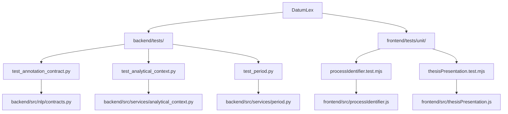

# Testes unitários no DatumLex

As setas ligam cada arquivo de teste ao módulo que ele exercita.



- [Contexto analítico](../backend/tests/test_analytical_context.py) cobre permissões por tribunal, validação de filtros e datas e identidade do contexto. Usa um usuário simulado e uma data fixa.
- [Data local](../backend/tests/test_period.py) cobre a diferença de data entre UTC e São Paulo na virada do dia.
- [Identificador de processo](../frontend/tests/unit/processIdentifier.test.mjs) cobre a máscara CNJ, zeros à esquerda e entradas já formatadas, livres ou ausentes.
- [Apresentação de teses](../frontend/tests/unit/thesisPresentation.test.mjs) cobre a escolha e a abreviação do título, o resumo explícito e a extração da primeira frase.

## Como executar

No PowerShell, entre no diretório `backend` e use o Python do ambiente virtual `.venv`:

```powershell
.\.venv\Scripts\python.exe -m pytest tests/test_analytical_context.py tests/test_period.py
```

Para executar a suíte completa, use `.\.venv\Scripts\python.exe -m pytest`. Se o ambiente virtual ainda não tiver o pytest, instale as dependências com `.\.venv\Scripts\python.exe -m pip install -r requirements-dev.txt`.

No diretório `frontend`, com Node.js disponível:

```powershell
npm test
```

Os testes unitários do frontend usam o executor nativo do Node.js. Os cenários de navegador com Playwright ficam em `frontend/tests/`. O backend também reúne testes de integração em `backend/tests/`. As ferramentas Python têm suítes próprias em `tools/nlp_validation/` e `tools/doctrine/`.

## Relatório HTML

Na raiz do projeto, execute:

```powershell
python scripts/test-report.py
```

A cada execução, o comando roda as 4 suítes (`Backend unitário`, `Backend completo`, `Frontend unitário` e `Ferramentas NLP`), executa análise estática (`Ruff` + `ESLint`), exporta os artefatos para o SonarQube (`output/coverage/backend-coverage.xml`, `output/coverage/backend-junit.xml` e `output/coverage/frontend-lcov.info`) e grava o painel HTML em **`output/coverage/index.html`** e em **`backend/tests/relatorio-cobertura.html`**.

## Qualidade de código e SonarQube

O projeto conta com configuração unificada de SonarQube em `sonar-project.properties` (`sonar.projectKey=br.edu.fatec:datumlex`, cobrindo Python em `backend/src` e React/JS em `frontend/src`, sem tokens hardcoded):

- **CI automático (`.github/workflows/sonar.yml`):** executa `python scripts/test-report.py`, valida `ruff check backend/src --select F` e `npm --prefix frontend run lint`, publica os artefatos de cobertura e envia a análise ao servidor SonarQube/SonarCloud quando os segredos `SONAR_TOKEN` e `SONAR_HOST_URL` estão configurados.
- **Execução local reproduzível (`docker-compose.sonar.yml`):**
  1. `python scripts/test-report.py`
  2. `docker compose -f docker-compose.sonar.yml up -d sonarqube`
  3. `SONAR_TOKEN=<seu-token> docker compose -f docker-compose.sonar.yml run --rm sonar-scanner`

O script usa `backend/.venv` quando disponível e precisa do Node.js no PATH. Para instalar o Coverage.py e as demais dependências de desenvolvimento no ambiente virtual do backend, execute na raiz do projeto:

```powershell
.\backend\.venv\Scripts\python.exe -m pip install -r backend/requirements-dev.txt
```

O backend roda com as configurações de teste, SQLite em memória e o carregamento do `.env` desativado. Os indicadores vêm da execução dos testes e da cobertura medida.

## Integração contínua no GitHub

1. Rode `python scripts/test-report.py` na raiz antes de enviar a mudança. Em `output/coverage/index.html`, confira os casos que falharam e as linhas sem cobertura nos arquivos alterados.
2. Inclua os testes, o gerador, as dependências e o workflow no commit da sua branch. Abra um pull request para `main`. Cada atualização do PR inicia a verificação **Testes DatumLex**.
3. Na aba **Checks** do PR, abra a execução para consultar o log. O resumo da execução em **Actions** oferece o artefato **cobertura-datumlex** quando o HTML foi gerado, inclusive quando um teste falha. Baixe o arquivo, extraia e abra `index.html`.
4. Após a primeira execução, um administrador pode tornar **Testes DatumLex** obrigatório na regra de proteção da `main`, em **Settings → Branches → Require status checks to pass before merging**. Mantenha também as verificações de integridade existentes.
5. Para reproduzir uma falha, rode o mesmo comando na branch do PR. Adicione um caso que reproduza o comportamento, faça a correção e envie o commit. A nova execução mostra se a regressão foi resolvida.
